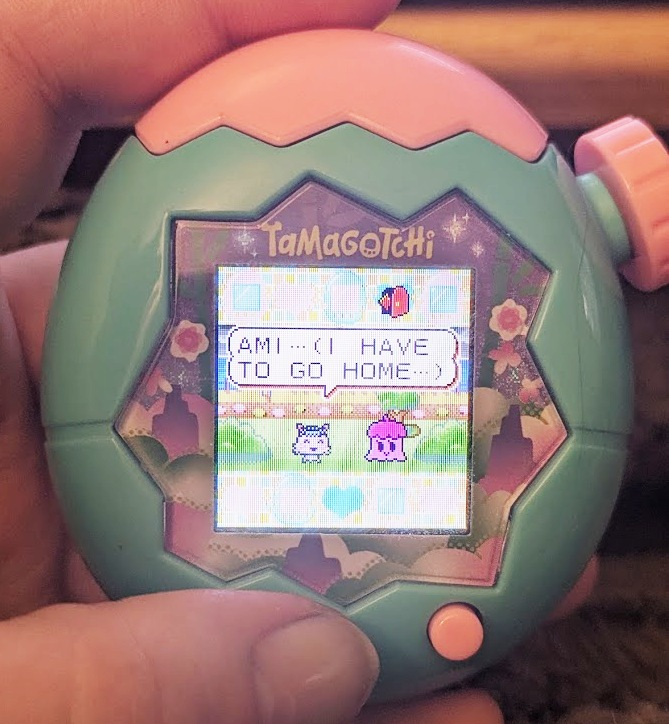
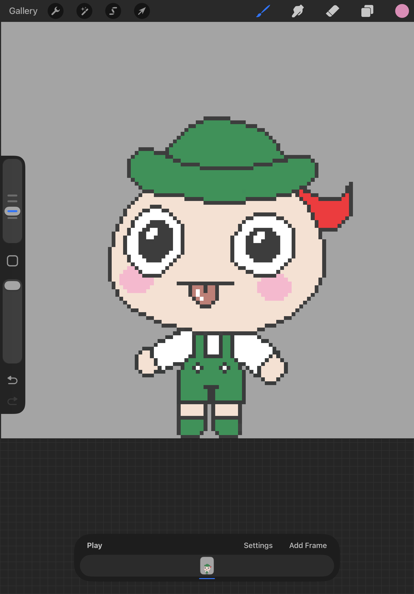
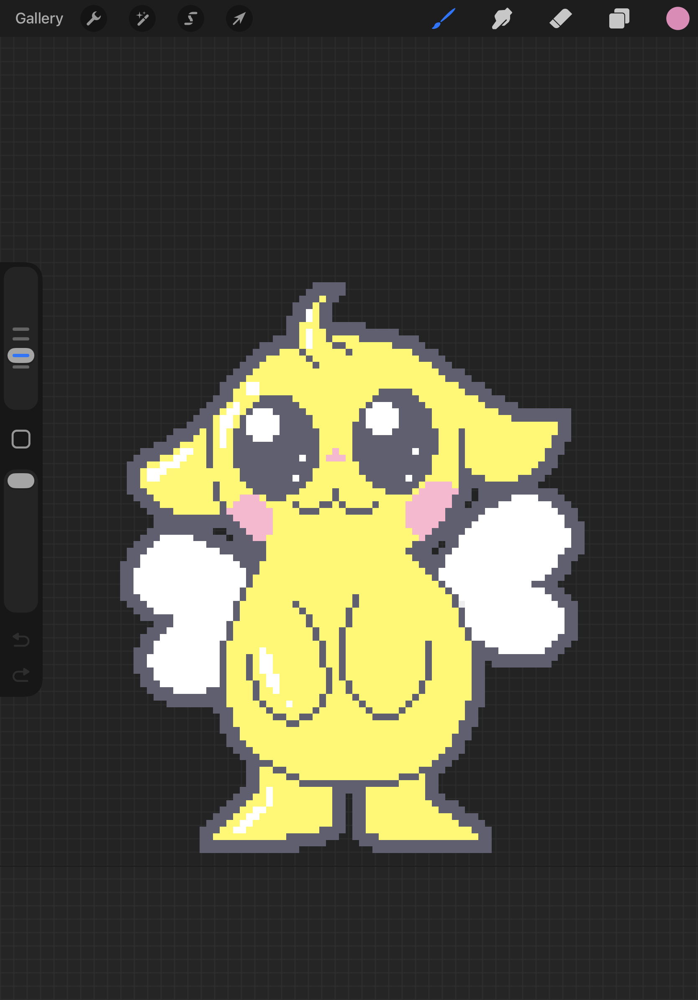
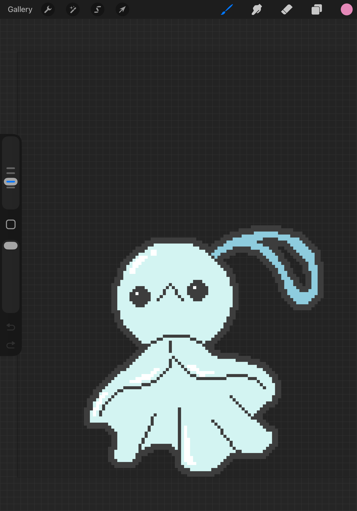
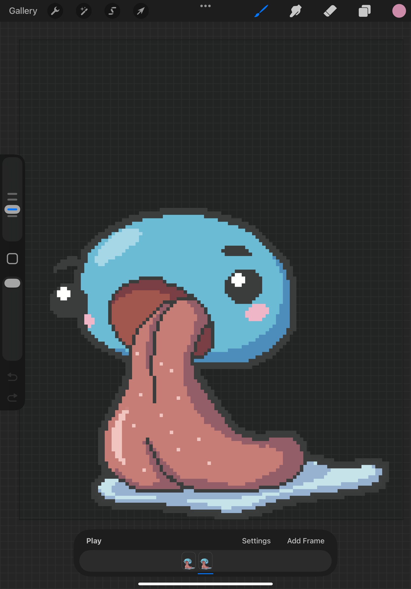

So, emulation of the Tama Paradise has become very much A Thing. Today I learned how to properly emulate the English Ps on my Paradise so that I could write [a guide on it](/guides/how-to-patch-english-emulator/).

I am thrilled to see what's become possible, and so, so happy that people can finally play the older and ridiculously expensive tamas. Including me! Because, let's be real, if I hadn't bought most of my collection in 2025, I definitely wouldn't own it now. I do occasionally snag a good deal online, but for the most part it's a jungle out there now.

I posted on reddit that people could DM me to ask where to get ROMs, and I've been inundated with messages, which makes me very happy. I'm not sure why, other than I'm excited to get to share this with people. I've also been keeping copies of all the ROMs that I come across, with the hopes that I can keep them up on archive.org if some get taken down. The Meets/On firmware got nuked a week or two ago and it kinda put the fear of god into me, lol. I know I'm not the sole proprietor of tamagotchi software preservation, but I just feel better knowing that the ROMs are "safe."

My ultimate goal is to contribute something major to the tama community, but because I am only just learning how to do electronics and programming, I don't really have the chops to be the next Mikablu or Maragotchi. But what I *do* have is time, and a bunch of old tamagotchi models that I got for hella cheap, so that's why I have decided to organize [Connecting the Dots](/preservation/), my silly name for a community effort to get the old Connection-era Tamagotchi firmware dumped and, hopefully, emulated. I've got a v4.5 and a v6 to donate. I do also have a 5 and 5.5, but those are the childhood tamas of a good friend (they sold them to me since they didn't play them anymore), and I wouldn't want to sacrifice them. I'm hoping that we get donors for those devices, or that I can get a good deal on one in bad condition.

The ROM dumping situation for the older models is a lot more complicated than for color tamas. It involves essentially using acid to remove the epoxy cap from the chip, and then using high-powered imaging to take photos of the ROM underneath. The process destroys the device, and it's not even a guarantee that you'll get an image good enough to result in a complete ROM. So, complicated.

At first, it was looking like we'd have to hire a decapping service, but after speaking with the legendary Azya for a few days, he's agreed to help us with the project as long as he doesn't have to manually verify all the bits in the ROM. So I'll be organizing a group of people to get that done! However, I don't currently know what his timeline looks like, so we may end up also hiring a decapsulation commissioner. He put me in touch with John McMaster, who runs a discord where folks can connect, but I haven't introduced myself yet since I'm not sure where we currently stand on that.

I've also started offering [Tama Paradise modding services on my ko-fi](https://ko-fi.com/katu/commissions)! I've seen a couple of people here and there who said that they'd love to have their device modded but aren't comfortable doing it themselves (or don't have a PC). While I personally will always encourage people to DIY (I mean, I wrote the guides for a reason), I do also understand that some people just don't feel comfortable with tech and don't mind paying someone to help them. Still, because it's so easy, I've decided not to charge much for it. After already paying for round trip shipping, I wouldn't wanna pay a ton on top of that, if it was me. And I'll be doing the first few for free to get reviews.

I also bought the hardware so that I can learn how to flash the Pix, Smart, Meets/On, 4U, and iD/L tonight, and it should arrive sometime in the next 2 weeks. I'm excited, but god I have no idea what I'm doing.

### Whimsykins update

Speaking of not knowing what I'm doing, I've been slowly plinking away at Whimsykins - which I might rename to WhimsyPet? That was my original title, but then I changed it because of catkins aka pussywillows, I just thought it was cute. But there's a few things called "whimsykins"/"whimsykinz" at the moment, and I'm not sure I want to try to compete. We'll see.

Anyway, I've made an [Instagram](https://www.instagram.com/whimsykins.vpet) for it, but I think I'll probably end up doing either Threads or BlueSky, because I am better at words than pictures when it comes to updates. Especially considering that I don't have much to show, yet - the game finally has A MENU though, I hope you're proud of me. It has two rooms, 1 animated sprite, 1 background, and a menu. And I am slowly tinking away at the art for it. But now it's bedtime, so I shall leave you with some of the characters so far:

    

    
         
        blertrand
    

    

    
         
        vleeshkin
    

    

    
         
        terubokin
    

    

    
         
        slofkin
    

